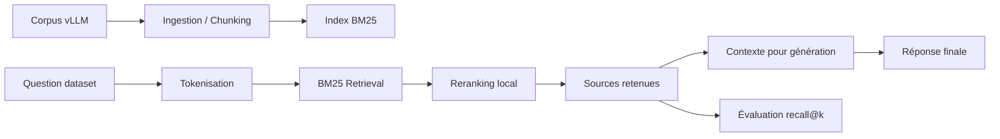

# Résumé complet du projet RAG

## Vision générale

Ce projet implémente un système de type RAG, c’est-à-dire un pipeline qui:

1. indexe un dépôt de code et de documentation,
2. récupère les passages les plus pertinents pour une question,
3. peut ensuite générer une réponse à partir des sources retrouvées.

L’objectif est de répondre à des questions sur le dépôt vLLM de manière fiable, reproductible et évaluée automatiquement.

## Architecture du projet

Le projet est organisé autour de quatre étapes principales:

- ingestion et indexation,
- recherche / retrieval,
- génération de réponse,
- évaluation locale.

Les composants principaux se trouvent dans [src/](src/):

- [src/ingestion.py](src/ingestion.py)
- [src/retrieval.py](src/retrieval.py)
- [src/generation.py](src/generation.py)
- [src/evaluation.py](src/evaluation.py)
- [src/models.py](src/models.py)
- [src/cli.py](src/cli.py)

## 1. Ingestion

Le module [src/ingestion.py](src/ingestion.py) lit le dépôt source, découpe les fichiers en morceaux, puis construit un index BM25.

### Rôle

- parcourir les fichiers autorisés du dépôt,
- ignorer les fichiers illisibles,
- découper les fichiers en chunks pertinents,
- conserver pour chaque chunk une métadonnée de type `MinimalSource`,
- construire et sauvegarder l’index sur disque.

### Stratégie de chunking

Le projet utilise des stratégies différentes selon le type de fichier:

- `.md`: découpage par titres / sections,
- `.py`: découpage par définitions `def` et `class`,
- autres fichiers: découpage générique par taille.

Cette approche évite d’avoir des chunks trop arbitraires et améliore la qualité du rappel.

### Tokenisation

Le projet tokenise le texte pour BM25 en conservant:

- les identifiants entiers,
- leurs sous-parties camelCase / snake_case,
- une forme normalisée légère pour les variantes morphologiques.

Le but est que des formulations proches puissent se retrouver même si le texte exact diffère légèrement.

## 2. Retrieval

Le module [src/retrieval.py](src/retrieval.py) charge l’index BM25 et exécute la recherche.

### Rôle

- recharger l’index et les métadonnées de chunks,
- tokeniser la question de la même manière que le corpus,
- récupérer les meilleurs candidats BM25,
- appliquer un reranking local léger,
- produire la liste finale de `MinimalSource`.

### Ce que fait le reranking

Le reranking favorise:

- les fichiers dans `docs/`,
- les fichiers Markdown,
- les chemins qui ressemblent à des sources de documentation,

et pénalise légèrement:

- les tests,
- les exemples,
- les benchmarks,
- les fichiers d’infrastructure annexe.

Cette heuristique a été ajoutée pour mieux coller au profil du dataset docs.

### Recherche par dataset

La fonction `search_dataset()` traite toutes les questions d’un fichier JSON, puis écrit un `StudentSearchResults` sur disque.

Elle sert directement aux tests de la moulinette.

## 3. Génération

Le module [src/generation.py](src/generation.py) prend les sources récupérées et génère une réponse finale avec un modèle de langage.

### Rôle

- relire les sources exactes depuis le disque,
- construire un contexte limité par un budget de tokens,
- interroger un modèle Hugging Face,
- renvoyer une réponse concise et grounded.

### Principe

Le projet utilise `Qwen/Qwen3-0.6B` comme modèle par défaut.

Le texte est injecté dans un prompt système qui demande explicitement de ne répondre qu’à partir du contexte fourni.

## 4. Évaluation

Le module [src/evaluation.py](src/evaluation.py) sert à mesurer la qualité des résultats locaux.

### Rôle

- charger les ground truths,
- charger les résultats étudiant,
- comparer les sources avec un critère d’IoU sur les plages de caractères,
- calculer des métriques de recall@k,
- afficher un rapport lisible.

### Utilité

Ce module permet de reproduire localement la logique d’évaluation de la moulinette et de diagnostiquer rapidement les erreurs de retrieval.

## 5. Modèles de données

Le fichier [src/models.py](src/models.py) définit les schémas Pydantic partagés par tout le projet.

### Modèles principaux

- `MinimalSource`: une source de texte identifiée par fichier + intervalle de caractères,
- `UnansweredQuestion`: une question sans réponse,
- `AnsweredQuestion`: une question avec sources et réponse de référence,
- `MinimalSearchResults`: le résultat de recherche pour une question,
- `MinimalAnswer`: le résultat enrichi d’une réponse générée,
- `RagDataset`: structure globale d’un dataset de questions,
- `StudentSearchResults`: format attendu pour `search_dataset`,
- `StudentSearchResultsAndAnswer`: format attendu pour `answer_dataset`.

Ces modèles garantissent que les fichiers JSON produits respectent exactement la forme attendue par les scripts de correction.

## 6. Interface CLI

Le fichier [src/cli.py](src/cli.py) expose les commandes du projet via `fire`.

### Commandes principales

- `index`: construit l’index BM25,
- `search`: cherche les sources pour une question unique,
- `search_dataset`: applique la recherche sur un dataset entier,
- `answer`: produit une réponse unique,
- `answer_dataset`: produit des réponses en lot,
- `evaluate`: calcule le recall localement.

Cette couche sert surtout de point d’entrée simple pour les scripts de test et pour l’usage manuel.

## 7. Exécution et structure disque

Le projet fonctionne avec:

- les sources du dépôt vLLM dans `data/raw/vllm-0.10.1/`,
- les datasets dans `data/datasets/`,
- l’index BM25 dans `data/processed/`,
- les sorties d’évaluation dans `evaluations/retrieval/`.

La commande de travail principale est basée sur `uv`, ce qui garantit un environnement reproductible.

## 8. Qualité et conformité

Le projet a été ajusté pour répondre aux contraintes de la moulinette:

- temps d’indexation sous la limite,
- throughput de retrieval conforme,
- recall docs au-dessus du seuil,
- recall code au-dessus du seuil.

Le test final de retrieval passe avec `4/4`.

## 9. Lecture rapide du pipeline

## 10. Ce qu’il faut retenir

Le projet est un RAG classique, mais robuste:

- il privilégie un retrieval lexical simple et rapide,
- il ajoute une normalisation légère pour mieux gérer les variantes de mots,
- il recentre le classement sur les fichiers de documentation,
- il reste compatible avec la moulinette.
